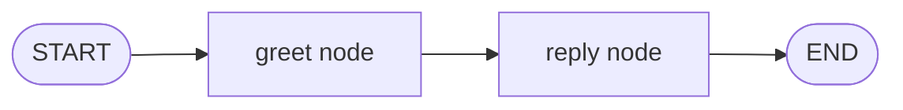

# LangGraph Basics

Use this for simple graph setup.

## Install

```bash
npm install @langchain/langgraph@latest
```

Install commands follow `../package-installation/npm.md`.

## Concepts

- Node: a function.
- Edge: a connection.
- Start: starting node.
- End: end node.
- State: variables that hold workflow data.

## Simple graph



```ts
import { START, END, StateGraph, Annotation } from "@langchain/langgraph";

const GraphState = Annotation.Root({
  message: Annotation<string>(),
});

type State = typeof GraphState.State;

const greet = async (state: State) => ({
  message: `Hello, ${state.message}`,
});

const reply = async (state: State) => ({
  message: `${state.message}. Welcome to LangGraph basics.`,
});

const graph = new StateGraph(GraphState)
  .addNode("greet", greet)
  .addNode("reply", reply)
  .addEdge(START, "greet")
  .addEdge("greet", "reply")
  .addEdge("reply", END)
  .compile();

const result = await graph.invoke({ message: "Imran" });
console.log(result.message);
```
